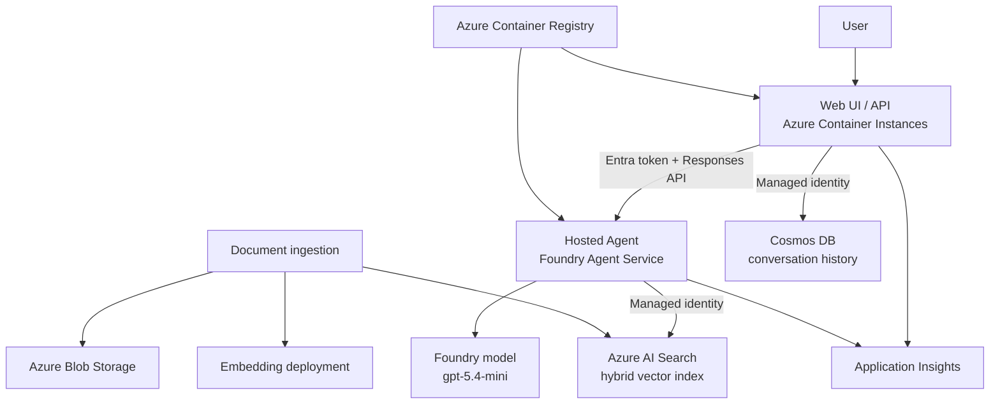

# Microsoft Foundry Hosted Agent — End-to-End Azure Reference Solution

This repository is a production-oriented reference implementation of an enterprise
knowledge assistant built with:

- Microsoft Foundry Agent Service Hosted Agents and the Responses protocol
- Microsoft Agent Framework for Python
- Azure OpenAI models in Microsoft Foundry
- Azure AI Search for hybrid vector retrieval
- Azure Cosmos DB for UI conversation history
- Azure Storage for source documents
- Azure Container Registry for application images
- Azure Container Instances for the web UI
- Managed identities and Azure RBAC (no application API keys)
- Optional VNet injection, NSGs, private endpoints/DNS, and existing hub firewall routing
- Azure Monitor, Application Insights, and Log Analytics
- Terraform and GitHub Actions with workload identity federation

The default application is a generic enterprise knowledge assistant. Change
`apps/agent/prompt.py` and upload your own documents to adapt it to another domain.

The repository is designed to be forked and published. It includes an MIT license,
community templates, Dependabot configuration, cross-version tests, Terraform
validation, and container-build checks.

> Microsoft renamed Azure AI Foundry to **Microsoft Foundry** and moved current
> agents to the Responses API/Agents v2 model. This repository follows the current
> July 2026 Hosted Agent architecture, while retaining the requested ACI-hosted web UI.

## Architecture



For the full trust-boundary and private-network diagram, see
[`docs/architecture.md`](docs/architecture.md).

## Repository layout

| Path | Purpose |
| --- | --- |
| `apps/agent` | Hosted Agent implementation and Azure AI Search tool |
| `apps/web` | FastAPI chat UI/API deployed to ACI |
| `apps/ingestion` | Blob upload, document extraction, chunking, embedding, and indexing |
| `infra/terraform` | Foundry, data, identity, network, container, and monitoring resources |
| `scripts` | Repeatable bootstrap, deploy, RBAC, ingestion, and smoke-test commands |
| `.github/workflows` | CI and OIDC-based deployment pipelines |
| `docs` | Architecture, security, operations, deployment, and cost guidance |
| `tests` | Unit and repository-contract tests that do not require Azure |
| `requirements-dev.txt` | Complete local and CI validation dependencies |

## Validate before deployment

Create a virtual environment and run every locally available check:

```bash
python3 -m venv .venv
source .venv/bin/activate
make setup-dev
make validate-local
```

To require Python, Node.js, ShellCheck, Terraform, and Docker:

```bash
make validate-all
```

The pull-request workflow independently runs Python 3.12 and 3.13 tests, Ruff,
ShellCheck, `terraform validate`, and all three container builds. See
[`docs/testing.md`](docs/testing.md) for the test boundary and cloud-smoke checks,
and [`TEST_RESULTS.md`](TEST_RESULTS.md) for the latest recorded validation run.

## Deployment modes

| Mode | Best for | Network posture | UI endpoint |
| --- | --- | --- | --- |
| `development` | Personal lab and functional testing | Public service endpoints, Entra/RBAC auth | Public ACI HTTP endpoint |
| `enterprise` | Internal production-aligned deployment | Foundry VNet injection, private endpoints, private DNS, optional hub firewall UDR | Private ACI IP; publish through your existing Application Gateway/WAF or private access path |

`enterprise` intentionally integrates with an **existing** hub firewall and ingress
layer. Enterprise landing zones normally own those shared components centrally.
The workload repository accepts the firewall private IP and creates workload UDRs;
it does not create a second Azure Firewall.

## Prerequisites

- Azure subscription with quota for the selected model deployments
- Azure CLI, Terraform 1.8+, Docker, Python 3.12+, and `jq`
- Azure Developer CLI only if you want the optional `azd` inner loop
- Permissions:
  - Contributor on the target resource group/subscription
  - Role Based Access Control Administrator (or Owner) for role assignments
  - Foundry Account Owner to create the Foundry account/project
  - Foundry Project Manager on the project to deploy Hosted Agent versions
- Registered resource providers listed in `scripts/register-providers.sh`
- For private mode, a deployment runner or workstation with DNS/network reachability
  to the workload VNet

Hosted Agent containers use a dedicated Entra agent identity. The post-deployment
step retrieves this identity and grants only Search Index Data Reader plus the
minimum data roles required by this sample.

## Quick start

### 1. Authenticate and configure

```bash
az login
az account set --subscription "<subscription-id>"
cp infra/terraform/environments/development.tfvars.example \
   infra/terraform/environments/development.tfvars
```

Edit the copied file. Resource names are generated from `project_name`,
`environment`, and a short random suffix.

### 2. Provision the Azure foundation

```bash
make init ENV=development
make plan ENV=development
make apply ENV=development
```

This first apply creates the Foundry project, model deployments, ACR, data services,
managed identities, and observability resources. It does not create the ACI web
container until an image URI is supplied.

### 3. Build and push images

```bash
make images ENV=development TAG="$(git rev-parse --short HEAD)"
```

### 4. Deploy the Hosted Agent and its data-plane permissions

```bash
make deploy-agent ENV=development TAG="$(git rev-parse --short HEAD)"
make agent-rbac ENV=development
```

The deployment script creates a new immutable Hosted Agent version, waits for it to
become active, routes the agent endpoint to that version, and records its identity.

### 5. Deploy the ACI web UI

```bash
make deploy-ui ENV=development TAG="$(git rev-parse --short HEAD)"
```

### 6. Ingest documents

Place PDF, DOCX, Markdown, or text files under `sample-data/` and run:

```bash
make ingest ENV=development SOURCE=sample-data
```

### 7. Verify

```bash
make smoke ENV=development
terraform -chdir=infra/terraform output
```

For a single orchestrated command after configuration:

```bash
./scripts/deploy.sh development
```

## GitHub Actions deployment

1. Create an Entra application/service principal with GitHub workload identity
   federation.
2. Add repository or GitHub Environment variables:
   `AZURE_CLIENT_ID`, `AZURE_TENANT_ID`, `AZURE_SUBSCRIPTION_ID`,
   `AZURE_CLIENT_OBJECT_ID`, `TF_STATE_RESOURCE_GROUP`,
   `TF_STATE_STORAGE_ACCOUNT`, and `TF_STATE_CONTAINER`.
3. Store environment-specific Terraform values as `TF_VAR_*` GitHub Environment
   variables, or provide a protected `.tfvars` file from your deployment process.
4. Run the `Deploy end-to-end` workflow.

For private mode, point `DEPLOY_RUNNER` at a self-hosted runner that can resolve and
reach the private endpoints.

To publish your own fork and configure branch protection, OIDC variables, security
features, and protected environments, follow
[`docs/github-setup.md`](docs/github-setup.md).

Common quota, RBAC, private-networking, image-pull, ingestion, and Terraform
problems are covered in [`docs/troubleshooting.md`](docs/troubleshooting.md).

## Security defaults

- Local/key authentication is disabled for Storage and Cosmos DB.
- Application code uses managed identity and `DefaultAzureCredential`.
- The ACI identity receives Foundry Agent Consumer, Cosmos data contributor, and
  ACR pull rights only.
- The Foundry project identity receives Foundry User plus conditional, project-scoped
  access to its Standard Setup data resources.
- The Hosted Agent identity receives Search Index Data Reader only.
- Public blob access and anonymous container access are disabled.
- Private mode disables public network access for the Foundry account and data
  services and creates private DNS zones/endpoints.
- No credentials are committed to the repository or injected into agent prompts.
- Request bodies are not written to logs by default.

> Current Hosted Agent limitation: the service-managed agent endpoint can remain
> publicly addressable even when its account and dependencies are private. Calls
> still require Entra authorization. Validate the current regional behavior before
> treating the endpoint itself as a private-only ingress boundary.

See [`docs/security.md`](docs/security.md) before a production deployment.

## Important production decisions

This is deployable code, but production ownership still requires explicit choices:

- TLS and ingress: put the private ACI endpoint behind your enterprise
  Application Gateway/WAF, API Management, or another approved ingress.
- End-user authentication: the middle tier is authenticated to Foundry using its
  managed identity. Add your organization’s Entra interactive sign-in or upstream
  identity-aware proxy before exposing the UI to users.
- Data classification and retention: set Cosmos TTL, Storage lifecycle, Search
  retention, and trace sampling to match policy.
- Model/data residency: validate region, deployment type, quota, and cross-region
  processing with your governance team.
- Responsible AI: test the system prompt, retrieval quality, content filters,
  prompt injection resistance, and domain-specific failure modes.

## Current platform references

- [Hosted agents in Foundry Agent Service](https://learn.microsoft.com/azure/foundry/agents/concepts/hosted-agents)
- [Deploy a Hosted Agent](https://learn.microsoft.com/azure/foundry/agents/how-to/deploy-hosted-agent)
- [Set up private networking](https://learn.microsoft.com/azure/foundry/agents/how-to/virtual-networks)
- [Hosted Agent permissions](https://learn.microsoft.com/azure/foundry/agents/concepts/hosted-agent-permissions)
- [Manage Hosted Agents and retrieve the agent identity](https://learn.microsoft.com/azure/foundry/agents/how-to/manage-hosted-agent)
- [Microsoft Agent Framework function tools](https://learn.microsoft.com/agent-framework/agents/tools/function-tools)

## Cleanup

Review the plan before destroying anything:

```bash
make destroy-plan ENV=development
```

To execute destruction, use Terraform directly only after checking the exact target
subscription, resource group, and plan. Removing the resource group permanently
deletes the agent, indexes, conversations, and uploaded documents.

## Contributing and license

Contributions are welcome. Read [`CONTRIBUTING.md`](CONTRIBUTING.md),
[`CODE_OF_CONDUCT.md`](CODE_OF_CONDUCT.md), [`SECURITY.md`](SECURITY.md), and
[`SUPPORT.md`](SUPPORT.md) before opening an issue or pull request.

This project is available under the [MIT License](LICENSE).
