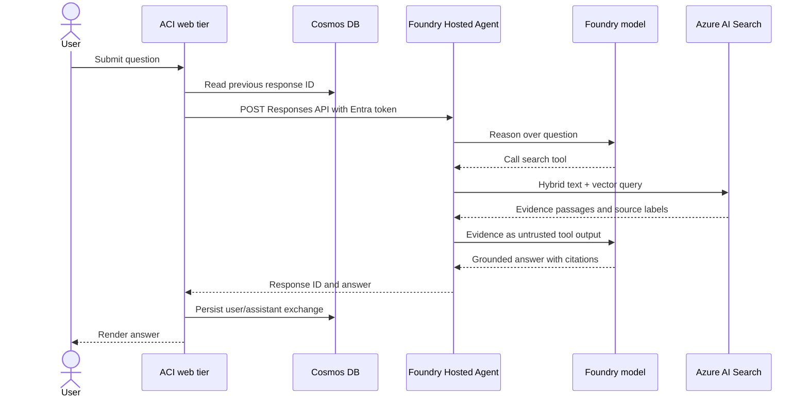
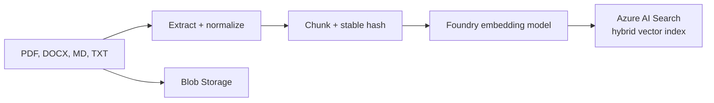
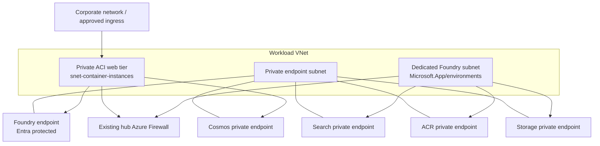

# Architecture

## Runtime request flow

The ACI identity is the only caller of the public Hosted Agent endpoint in this
solution. Humans do not receive an Azure credential or call the Agent Service
directly.

## Document ingestion flow

Re-ingesting a document replaces its existing chunks by `source_uri`, so an updated
file does not leave stale duplicate passages in the index.

## Private deployment topology

The private deployment creates and links these private DNS zones:

| Service | Private DNS zone |
| --- | --- |
| Foundry | `privatelink.cognitiveservices.azure.com` |
| Foundry models | `privatelink.openai.azure.com` |
| Foundry project/agents | `privatelink.services.ai.azure.com` |
| Search | `privatelink.search.windows.net` |
| Cosmos DB | `privatelink.documents.azure.com` |
| Blob Storage | `privatelink.blob.core.windows.net` |
| Container Registry | `privatelink.azurecr.io` |

In a hub-and-spoke landing zone, replace the locally created zones with data sources
or provider aliases that reference the centrally managed DNS zones. Do not deploy
duplicate private zones with the same name in peered networks.

The Foundry account/project data plane uses the private endpoint from inside the
VNet. The current Hosted Agent endpoint can remain publicly addressable as a
service-managed preview endpoint; Entra authorization is therefore a required
boundary even in private mode.

## Identity and authorization map

| Principal | Scope | Role | Purpose |
| --- | --- | --- | --- |
| Foundry project system identity | Foundry project | Foundry User | Project data-plane and model access |
| Foundry project system identity | Storage account | Storage Blob Data Contributor + conditional Storage Blob Data Owner | Standard Setup state/file storage, limited to the project’s agent containers |
| Foundry project system identity | Search service | Search Service Contributor + Search Index Data Contributor | Standard Agent vector-store management |
| Foundry project system identity | Cosmos account / `enterprise_memory` database | Cosmos DB Operator + SQL Data Contributor | Standard Setup thread storage |
| Foundry project system identity | ACR | AcrPull | Hosted Agent image pull |
| Hosted Agent instance identity | Search service | Search Index Data Reader | Runtime RAG lookup |
| ACI web user-assigned identity | Foundry project | Foundry Agent Consumer | Invoke the agent endpoint only |
| ACI web user-assigned identity | Cosmos account | SQL Data Contributor | Persist UI conversations |
| ACI web user-assigned identity | ACR | AcrPull | Pull the web image |
| CI/CD principal | ACR, Foundry project, Storage, Search | AcrPush, Foundry Project Manager, Storage Blob Data Contributor, Search Service Contributor, Search Index Data Contributor | Deploy images/versions and run ingestion |

The Hosted Agent identity does not exist until an agent is first deployed. Therefore
its Search role is deliberately applied by `scripts/post-deploy-rbac.sh` after the
version becomes active.

## Availability and scale

- Hosted Agent compute is managed and scaled by Foundry Agent Service.
- The sample uses one Search replica outside production and two in production.
- Cosmos uses Session consistency and one region by default.
- ACI is a single container group and is appropriate for a lightweight internal UI,
  but it is not a multi-replica web platform.

For a strict availability target, move the unchanged web container to Azure Container
Apps or App Service with multiple replicas and zone redundancy. The Hosted Agent,
Search, Cosmos, Storage, and identity contracts remain the same.

## Key architectural decisions

1. **Responses protocol, not legacy Threads/Runs.** This follows the current Foundry
   Agents v2 resource model.
2. **Hosted code plus function tool.** The agent controls retrieval behavior in
   version-controlled Python rather than an out-of-band portal configuration.
3. **Independent UI history.** Cosmos stores a user-facing audit/history view while
   the Responses API maintains model conversation continuity with response IDs.
4. **No application secrets.** Both runtime components use Entra identities.
5. **Two deployment profiles.** Public development mode makes validation practical;
   private enterprise mode enforces the network boundary.
